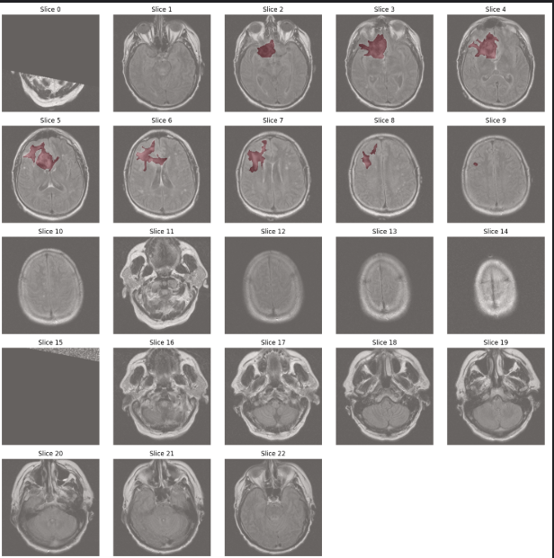
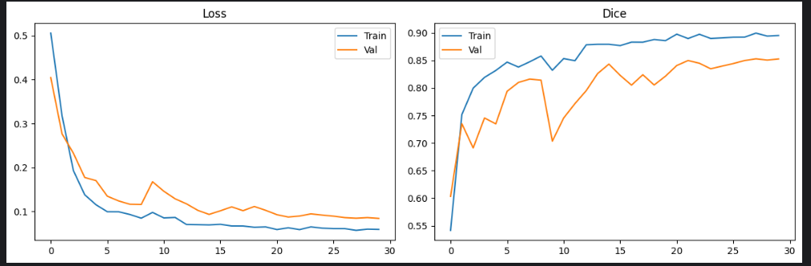
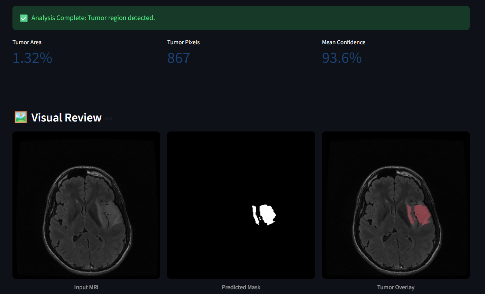

# CerebraScan

Brain tumor segmentation from MRI using **ResU-Net** (PyTorch) + **Streamlit** web app.

---

## 🎯 Project Overview

- **Goal:** Automatically segment brain tumors from MRI scans.
- **Model:** ResU-Net (ResNet34 encoder + U-Net decoder).
- **Framework:** PyTorch + segmentation-models-pytorch.
- **UI:** Streamlit.
- **Dataset:** LGG MRI Segmentation (Kaggle / TCGA).

### Kaggle Notebook

The complete end-to-end notebook, including the completed training and
experimentation stages, is available on Kaggle:

**[Open the CerebraScan Kaggle Notebook](https://www.kaggle.com/code/deepakak47/cerebrascan)**

---


## 📂 Project Structure

```text
CerebraScan/
├── data/
│   ├── raw/                     # dataset (optional sample)
│   └── splits/                  # train.txt, val.txt, test.txt
├── models/
│   ├── unet.py                  # ResU-Net model
│   └── weights/
│       ├── best_model.pth       # trained weights
│       └── curves.png           # training curves
├── src/
│   ├── dataset.py               # PyTorch Dataset + DataLoader
│   ├── utils.py                 # Loss + metrics
│   ├── train.py                 # training script
│   └── predict.py               # inference
├── app/
│   └── streamlit_app.py         # Streamlit UI
├── notebook/
│   ├── eda.ipynb
│   └── README.md                # link to the complete Kaggle notebook
├── render.yaml                  # Render deployment configuration
├── venv/
├── .env
├── .gitignore
├── requirements.txt
└── README.md
```


---

## 📊 Dataset

- **Name:** LGG MRI Segmentation
- **Source:** [Kaggle](https://www.kaggle.com/datasets/mateuszbuda/lgg-mri-segmentation) (TCGA LGG collection)
- **Patients:** 110
- **Slices:** ~3,929 image-mask pairs
- **Image shape:** (256, 256, 3)
- **Mask shape:** (256, 256) — binary (0 or 1)

### Image Channels
| Channel | Sequence |
|---|---|
| 1 | Pre-contrast |
| 2 | FLAIR |
| 3 | Post-contrast |

### File Naming


---

## ✅ Progress

### Stage 1 — Project Setup
- [x] Folder structure created
- [x] Virtual environment (`venv/`)
- [x] `requirements.txt`
- [x] `.gitignore`
- [x] `README.md`

### Stage 2 — Data Exploration (EDA)
- [x] Dataset loaded via `kagglehub`
- [x] 110 patient folders verified
- [x] Image shape confirmed `(256, 256, 3)`
- [x] Mask shape confirmed `(256, 256)`, binary
- [x] 3 channels visualized (Pre / FLAIR / Post)
- [x] Image + mask overlay verified
- [x] Class balance: **~34.9% tumor / ~65.1% empty**
- [x] Tumor area distribution plotted

#### Howd data look? Here's a sample overlay of MRI slices with tumor masks:



**Key findings:**
| Item | Value |
|---|---|
| Image shape | (256, 256, 3) |
| Mask shape | (256, 256) |
| Mask values | 0 / 1 |
| Tumor slices | ~33.6% |
| Empty slices | ~66% |
| Best channel | FLAIR |
| Main issue | Class imbalance |
| Loss choice | Dice + BCE |
| Split strategy | By patient |

### Stage 3 — Patient-wise Data Splitting
- [x] 110 patients shuffled (seed=42)
- [x] Split: 80 train / 15 val / 15 test
- [x] No overlap check passed
- [x] Saved as `train.txt`, `val.txt`, `test.txt`

**Split stats:**
| Set | Patients | Slices |
|---|---|---|
| Train | 80 | ~3016 |
| Val | 15 | ~363 |
| Test | 15 | ~550 |

### Stage 4 — Data Pipeline (`dataset.py`)
- [x] `build_pairs()` flattens folders → `(image, mask)` pairs
- [x] `BrainMRIDataset` custom PyTorch Dataset
- [x] Augmentations (flip, rotate, shift-scale) using albumentations
- [x] Normalize with ImageNet stats
- [x] `DataLoader` with batch size 16
- [x] Verified batch shapes: `(16, 3, 256, 256)` + `(16, 1, 256, 256)`


### Stage 5 — Model (`unet.py`)
- [x] Built ResU-Net via `segmentation-models-pytorch`
- [x] Encoder: **ResNet34** (ImageNet pretrained)
- [x] Decoder: U-Net style with skip connections
- [x] Input: (3, 256, 256) → Output: (1, 256, 256)
- [x] Total params: ~24.4M

### Stage 6 — Loss + Optimizer (`utils.py`)
- [x] Dice Loss
- [x] BCEWithLogitsLoss
- [x] Combined Loss (0.5 Dice + 0.5 BCE)
- [x] Metrics: Dice coefficient, IoU
- [x] Optimizer: Adam (lr=1e-4)
- [x] Scheduler: ReduceLROnPlateau

### Stage 7 — Training (`train.py`)
- [x] Trained on Kaggle GPU (T4 x2)
- [x] Epochs: 30
- [x] Batch size: 16
- [x] Saved best model by validation Dice → `best_model.pth`
- [x] Plotted training curves → `curves.png`
- [x] Best Val Dice: **0.6480** (updating as training continues)



The training curves show that the loss decreases steadily while the Dice score
improves across epochs. Training and validation metrics remain reasonably
consistent, indicating that the model learns useful tumor-segmentation features
without severe overfitting.

### Stage 8 — Inference and Prediction (`predict.py`)

After training, the saved `best_model.pth` checkpoint is used to predict tumor
regions on new MRI slices. The uploaded image is resized to `256 × 256`,
normalized with the same ImageNet statistics used during training, and passed
through the ResU-Net model.



The prediction result is presented in three views:

- **Input MRI:** The original uploaded MRI slice used for inference.
- **Predicted tumor mask:** A binary mask generated by applying the selected
  segmentation threshold to the model's pixel-wise probabilities. White pixels
  represent the predicted tumor region.
- **MRI + segmentation overlay:** The predicted region highlighted in red and
  blended with the original MRI to make the result easier to review.

The application also reports the estimated tumor area, number of tumor pixels,
and mean prediction confidence. The predicted mask and overlay can be
downloaded as PNG files. This output is intended for research and visual
review, not for medical diagnosis.

### Stage 9 — Streamlit Web App (`app/streamlit_app.py`)

The trained model is available through an interactive Streamlit application.
Users can upload a JPG, PNG, or TIFF MRI slice, adjust the segmentation
threshold, and run inference directly from the browser. The app displays the
input MRI, predicted tumor mask, and segmentation overlay, along with tumor
area, tumor pixel count, and mean confidence metrics.

### Stage 10 — Deployment Preparation

- [x] Streamlit app prepared for hosted deployment
- [x] Dependency file prepared as `requirements.txt`
- [x] Model path resolved relative to the project root
- [x] Upload, inference, visualization, and result downloads verified locally

#### Important deployment note

This project will be deployed as a Streamlit web service on
[Render](https://render.com/). Render runs the Streamlit server as a
long-running web service and provides the public application URL.

Before deploying, make sure `models/weights/best_model.pth` is available to
the host. The checkpoint is approximately 98 MB and is intentionally ignored
by Git. Store it using Git LFS or a model-artifact store, then update
`WEIGHTS_PATH` or the deployment environment so the app can load it.

#### Render deployment

The repository includes [`render.yaml`](render.yaml), which defines the
required Python environment, dependency installation command, and Streamlit
start command. To deploy:

1. Push the repository to GitHub.
2. In Render, choose **New → Blueprint** and select the repository.
3. Confirm the settings from `render.yaml`.
4. Deploy the service and open the generated public URL.

The equivalent Render settings are:

```text
Build command: pip install -r requirements.txt
Start command: streamlit run app/streamlit_app.py --server.address 0.0.0.0 --server.port $PORT
```

---

## 🚧 Future Work

- [ ] Monitor the deployed Render service and model performance

## ▶️ Run the app

From the repository root:

```bash
streamlit run app/streamlit_app.py
```

Install dependencies first:

```bash
pip install -r requirements.txt
```

The app accepts JPG, PNG, and TIFF MRI slices, displays the predicted mask and
overlay, and provides downloadable PNG results. The checkpoint path is resolved
from the app location, so the command also works when launched from another
working directory.

---

## 🛠️ Tech Stack

| Category | Tools |
|---|---|
| Language | Python 3.11 |
| DL Framework | PyTorch, segmentation-models-pytorch |
| Data | NumPy, Pandas, PIL, OpenCV |
| Augmentation | Albumentations |
| Visualization | Matplotlib |
| UI | Streamlit |
| Training | Kaggle Notebooks (free GPU) |
